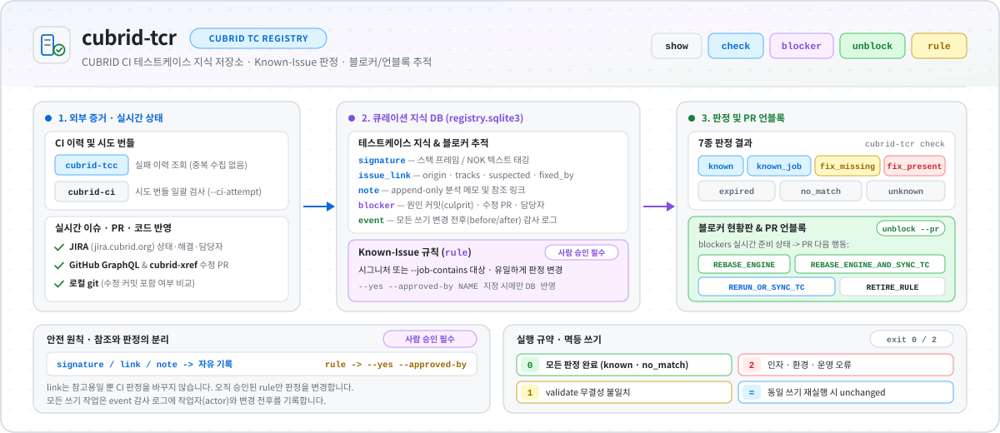
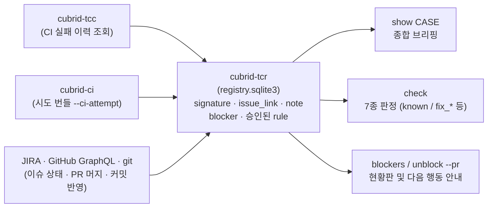

<div align="center">

<picture>
  <source media="(prefers-color-scheme: dark)" srcset="assets/readme/hero-dark.svg">
  <source media="(prefers-color-scheme: light)" srcset="assets/readme/hero-light.svg">
  
</picture>

# CUBRID TC Registry (`cubrid-tcr`)

**CUBRID CI 테스트케이스의 실패 시그니처, 연관 JIRA, 사람 승인 Known-Issue 규칙, 블로커 및 PR 언블록 상태를 관리하는 지식 저장소이자 판정관.**

[한눈에 보기](#한눈에-보기--왜-만들었나요) ·
[tcc vs tcr](#cubrid-tcc-vs-cubrid-tcr-둘은-어떻게-다른가요) ·
[저장 지식과 안전 원칙](#저장하는-지식과-핵심-안전-원칙-참조와-판정의-분리) ·
[실전 사용법](#실전-사용-시나리오) ·
[CI 시도 일괄 검사](#cubrid-ci-시도-단위-일괄-검사-check---ci-attempt) ·
[전체 명령어](#전체-명령어-요약-및-운영-규약) ·
[저장소 및 개발](#저장소-환경변수-및-개발)

</div>

---

## 한눈에 보기 — 왜 만들었나요?

CI가 깨졌을 때 가장 먼저 드는 의문은 보통 두 가지입니다.

1. **"이 테스트가 최근 어떤 PR과 브랜치에서, 어떤 증상(스택/에러)으로 깨졌지?"**
2. **"지금 내 PR에서 터진 실패가 이미 알려진 이슈(Known Issue)인가, 아니면 수정 커밋이 `develop`에 이미 들어갔는데 내 PR이 리베이스가 안 된 건가?"**

[`cubrid-tcc`](https://github.com/vimkim/cubrid-tc-chronicle)(Chronicle)가 **"언제, 어느 커밋과 PR에서 실패했는가"라는 CI 사실 이력**을 기록한다면, `cubrid-tcr`(Registry)은 그 실패에 대한 **팀의 판단과 큐레이션 지식**을 관리합니다.

- `cubrid-tcc`가 수집한 이력을 중복 저장하지 않고 그대로 조회합니다.
- 스택 프레임이나 NOK 에러 문구(`signature`), 연관 JIRA 이슈(`issue_link`), 분석 메모(`note`), 사람 승인 Known-Issue 규칙(`rule`), 원인 커밋·수정 PR·담당자(`blocker`)를 관리합니다.
- JIRA 해결 상태, GitHub PR 머지 상태, 로컬 `git` 커밋 반영 여부를 교차 확인해 **"아직 Known Issue인지"**, **"이미 수정이 들어갔으니 리베이스하면 언블록되는지"**를 판정합니다.

---

## `cubrid-tcc` vs `cubrid-tcr`, 둘은 어떻게 다른가요?

두 도구는 역할을 깔끔하게 나누어 서로 중복 없이 연동됩니다.

| 구분 | [`cubrid-tcc` (Chronicle)](https://github.com/vimkim/cubrid-tc-chronicle) | `cubrid-tcr` (Registry, 본 저장소) |
|---|---|---|
| **핵심 역할** | CI **사실 이력(History)** 수집·인덱싱 | 실패에 대한 **팀 지식·판단·블로커** 관리 및 판정 |
| **저장 내용** | 실행(`run`), 샤드, PASS/FAIL 결과, PR 메타데이터, 원본 로그 체크섬 | `signature`, `occurrence_signature`, `issue_link`, `note`, `rule`, `blocker`, `event` |
| **데이터 출처** | GitHub Actions (`gha-ci`) &amp; 내부 결과 저장소 | 사람의 분석·승인 + `cubrid-tcc` / `cubrid-ci` / JIRA / GitHub / `git` 연동 |
| **쓰기/승인 원칙** | CI 실행 결과를 변경 없이 원자적으로 색인 | `signature`/`link`/`note`/`blocker`는 기록 가능, **`rule`은 사람 승인(`--yes --approved-by`) 필수** |
| **대표 질문** | *"이 테스트 최근 14일간 몇 번 깨졌어? 플래키해?"* | *"이 코어 덤프가 Known Issue야? 수정 PR 머지돼서 내 PR 리베이스해도 돼?"* |



---

## 저장하는 지식과 핵심 안전 원칙 ("참조와 판정의 분리")

`cubrid-tcr`은 **참조용 지식**과 **CI 판정을 바꾸는 규칙**을 엄격히 분리합니다.

| 레코드 | 역할 | 누가 기록할 수 있나요? | CI 판정 영향 |
|---|---|---|---|
| `signature` | 실패 모양 정의 (안쪽 프레임 우선 스택 프레임 목록 + 필수 문자열, 또는 코어 없는 NOK/에러 메시지용 텍스트 전용 시그니처) | 사람 / 에이전트 / 스크립트 | 직접 바꾸지 않음 |
| `occurrence_signature` | `cubrid-tcc`의 특정 실패 건(`run`, `shard`, `ordinal`)에 매칭된 시그니처 태깅 | 사람 / 에이전트 / `--record` | 직접 바꾸지 않음 |
| `issue_link` | 테스트케이스 ↔ JIRA 이슈 관계 (`origin`, `tracks`, `suspected`, `fixed_by`) | 사람 / 에이전트 | **절대 판정을 바꾸지 않음** |
| `note` | 분석 경과, 관련 PR/실행 링크 등을 남기는 append-only 메모 | 사람 / 에이전트 | 직접 바꾸지 않음 |
| `blocker` | 장애 블로커 추적(원인 커밋/PR `culprit`, 수정 이슈, 필수/선택 수정 PR, 담당자) | 사람 / 에이전트 | 연결된 `rule`의 `fix_*` 판정과 `unblock` 안내에 반영 |
| `rule` | **유일하게 `check` 판정을 바꾸는 레코드** (시그니처 또는 `--job-contains` 대상) | **오직 사람만 승인 가능** (`--yes --approved-by NAME`) | **`known` / `known_job` / `fix_*` 등 판정 결정** |
| `event` | 모든 쓰기 작업의 작업자(`actor`), 명령, 변경 전후(`before`/`after`) 감사 로그 | 시스템 자동 기록 | 감사 추적용 |

> [!IMPORTANT]
> **왜 `rule`만 사람 승인 필수인가요?**
> AI 에이전트나 자동화 스크립트가 새로운 실패를 성급하게 "알려진 이슈(Known Issue)"로 가려버리면 실제 회귀(regression)가 묻힐 위험이 있습니다. 따라서 `signature`, `link`, `note`는 자유롭게 축적하되, 판정을 바꾸는 `rule add`는 반드시 `--yes --approved-by <승인자>` 없이는 드라이런(dry-run)만 출력합니다.

---

## 실전 사용 시나리오

### ① 특정 TC의 종합 브리핑 보기 (`show`)

실패를 처음 마주쳤을 때, 해당 테스트케이스의 최근 실패 이력과 팀이 기록해 둔 이슈·메모·규칙·블로커를 한 번에 봅니다.

```bash
# 단편 이름으로 조회 (cubrid-tcc find가 1개로 해석할 때)
cubrid-tcr show cbrd_27179

# 최근 30일만 보거나 전체 이력 보기 + 블로커의 실시간 JIRA/GitHub PR 상태까지 조회
cubrid-tcr show cbrd_27179 --days 30 --live
cubrid-tcr show sql/_36_guava/cbrd_27461/cases/cbrd_27461.sql --suite sql --all
```

- `cubrid-tcc`에서 실패 이력을 읽어 **PR별·브랜치별·시그니처별 요약**과 함께 `links`, `signatures`, `blockers`, `rules`, `notes`를 출력합니다.
- 색인된 실패가 **50건 이하**이면 전체를 나열하고, **50건을 초과**하면 **최근 60일 상세 목록 + 이전 이력 요약**으로 자동 정리합니다.

---

### ② 실패가 알려진 이슈인지 판정하기 (`check`)

특정 실패가 이미 등록된 `rule`에 해당하는지, 수정이 이미 `develop`에 들어갔는지 판정합니다.

```bash
# 단건 실패 판정 (코어 백트레이스 또는 NOK 에러 메시지 파일 전달)
cubrid-tcr check --case cbrd_27179 --suite shell --engine cd24a21 --stack-file core.txt

# 테스트케이스 저장소 SHA까지 함께 검증할 때
cubrid-tcr check --case cbrd_27179 --suite shell --engine cd24a21 --tc-sha a1b2c3d --stack-file core.txt

# 잡 단위 노이즈 규칙 확인 (예: shard sql_by_cci 01)
cubrid-tcr check --job "shard sql_by_cci 01" --engine cd24a21

# 네트워크 없이 오프라인 판정 (--engine-repo 없이도 실행 가능)
cubrid-tcr check --case cbrd_27179 --suite shell --engine cd24a21 --stack-file core.txt --offline
```

> [!NOTE]
> `--offline` 없이 `check`를 실행할 때는 `--engine-repo` 또는 환경변수 `TCR_ENGINE_REPO`가 유효한 CUBRID 엔진 Git 체크아웃을 가리켜야 합니다(미설정 시 종료 코드 `2`). `check`는 자동으로 `git fetch`를 실행하지 않으므로, 로컬 체크아웃의 `origin/develop`이 오래되면 최근 머지된 수정 커밋을 놓칠 수 있습니다.
> 단, 테스트 대상 엔진 커밋이 로컬 체크아웃에 없는 경우에도 `origin/develop`에서 관련 수정 커밋을 찾은 뒤 GitHub Compare API(`gh api repos/CUBRID/cubrid/compare/...`)로 반영 여부를 조회합니다.

#### 7가지 판정값(Verdict) 해설

| 판정값 (`verdict`) | 의미 | 후속 조치 |
|---|---|---|
| `known` | 시그니처 규칙에 매칭되었고 유효 기간 내이며, 연결된 JIRA가 미해결이거나 블로커 필수 수정 PR이 아직 머지되지 않음 | 기존 블로커/이슈에서 추적 중인 알려진 실패 |
| `known_job` | `--job-contains` 잡 규칙에만 매칭됨 (해당 잡 자체가 불안정한 것으로 알려져 있으나, 개별 실패 원인은 별도 분석 필요) | 시그니처 규칙 `known`보다 낮은 우선순위 — 개별 증상 확인 필요 |
| `fix_missing` | 매칭된 규칙의 JIRA가 `Fixed` 또는 `Done`이거나 블로커 필수 PR이 대상 브랜치에 머지되었으나, 테스트된 커밋(`--engine` / `--tc-sha`)에는 수정 커밋이 **포함되지 않음** | 최신 `develop`으로 PR 리베이스 또는 TC 브랜치 동기화 후 재실행 |
| `fix_present` | 수정 커밋이 테스트된 커밋에 **이미 포함되어 있는데도** 다시 실패함 | 수정이 불완전하거나 다른 원인/회귀일 가능성 — 신규 분석 필요 |
| `expired` | 매칭된 규칙의 만료일(`--expires`)이 지남 | 현재 상태 재확인 후 규칙 연장 또는 은퇴(`rule retire`) |
| `no_match` | 매칭된 활성 규칙이 전혀 없음 | 신규 실패이거나 아직 규칙이 없는 실패 — 분석 진행 |
| `unknown` | 스택/실패 텍스트가 없어 비교 불가, 오프라인 상태, JIRA/GitHub 조회 실패, 또는 JIRA 해결값이 `Fixed`/`Done` 외(`Won't Fix` 등)임 | `--stack-file` 전달 또는 네트워크/권한 및 이슈 해결값 확인 |

여러 규칙이 동시에 매칭되면 `fix_present` → `expired` → `unknown` → `fix_missing` → `known` → `known_job` 순으로 보수적(재분석이 필요한) 판정이 전체 `verdict`로 채택됩니다.

---

### ③ 블로커 추적 &amp; 내 PR 언블록 여부 확인 (`blocker`, `blockers`, `unblock`)

블로커는 여러 테스트케이스나 PR을 동시에 막고 있는 장애를 **원인 커밋/PR(`culprit`), 수정 이슈(`--fix-issue`), 필수/선택 수정 PR(`--pr`, `--pr-optional`), 담당자(`--owner`)** 단위로 1급 객체로 추적합니다.

#### 1) 블로커 등록 및 PR 연결

```bash
# 원인 PR/커밋 자동 조회(--culprit)와 함께 블로커 등록
cubrid-tcr blocker add CBRD-28395 \
  --title "vacuum slot assertion" \
  --culprit engine#8537 \
  --fix-issue CBRD-28395 \
  --pr engine#8601 \
  --pr-optional tc-private#120 \
  --signature sig-cbrd-27179

# 나중에 수정 PR을 추가하거나 기존 규칙을 블로커에 연결
cubrid-tcr blocker pr add CBRD-28395 engine#8610
cubrid-tcr blocker link CBRD-28395 --rule rule-cbrd-27179
```

- `--culprit`에는 `engine#8537`, `tc#4474`, `tc-private#123`, GitHub PR URL, 또는 커밋 SHA를 넣을 수 있으며 온라인 모드에서 저장소·PR 번호·커밋 SHA·CBRD 이슈·작성자를 자동 추출합니다.
- `--pr`은 `READY` 판정에 반드시 머지되어야 하는 필수 수정 PR, `--pr-optional`은 선택(비차단) PR입니다.

#### 2) 전체 블로커 현황판 보기 (`blockers`)

```bash
# 활성 블로커의 실시간 JIRA/GitHub PR 준비 상태 조회
cubrid-tcr blockers

# 최근 7일간 이 블로커로 깨진 오픈 PR까지 함께 확인
cubrid-tcr blockers --affected-days 7

# 머지가 끝나 바로 언블록 가능한 블로커만 필터링
cubrid-tcr blockers --ready-only --branch develop
```

- **실시간 준비 상태(`readiness`)**:
  - `READY`: 모든 필수 수정 PR이 대상 브랜치(기본 `develop`)에 머지됨 (또는 필수 PR이 없더라도 JIRA가 `Fixed`/`Done`이고 로컬 `origin/develop`에 `[<ISSUE>]` 커밋이 존재함)
  - `PARTIAL`: 일부 필수 PR은 머지되었고 나머지는 아직 `OPEN`/`DRAFT`
  - `IN_PROGRESS`: 수정 PR이 `OPEN`/`DRAFT` 상태로 진행 중 (미지정 시 `cubrid-xref`로 이슈 연관 PR 자동 탐색, `--no-discover`로 생략 가능)
  - `NEEDS_FIX_PR`: `fix_issue`는 있으나 열린/머지된 수정 PR이 없음
  - `BRANCH_MISMATCH`: 필수 PR이 지정된 `target_branch`가 아닌 다른 브랜치에 머지됨
  - `UNTRACKED` / `UNKNOWN`: 수정 이슈·PR 정보가 없거나 오프라인/조회 실패 상태
- **담당자(`owner`) 자동 결정 우선순위**:
  1. JIRA 이슈 담당자 (`jira`)
  2. 비봇(`cubrid-tc-sync-bot` 제외) 수정 PR 작성자 (`fix_pr`)
  3. 로컬 `--owner` 지정값 (`local`)
  4. 원인 커밋/PR 작성자 (`culprit`)

#### 3) 내 PR이 이제 언블록되었는지 확인하기 (`unblock`)

```bash
cubrid-tcr unblock --pr 8753
```

`cubrid-tcc`에서 해당 PR의 최신 실패 목록을 가져와 각 실패를 시그니처·블로커·규칙과 연결한 뒤, 스위트별 상태(`READY TO UNBLOCK`, `STILL BLOCKED`, `NEEDS ANALYSIS`)와 **구체적인 다음 행동(`unblock_action`)**을 출력합니다.

| `unblock_action` | 의미 및 권장 행동 |
|---|---|
| `REBASE_ENGINE` | 엔진(`CUBRID/cubrid`) 수정 PR이 머지됨 → 엔진 PR을 `develop` 기준으로 리베이스/머지 후 재실행 |
| `REBASE_ENGINE_AND_SYNC_TC` | 엔진과 TC 저장소 수정 PR이 모두 머지됨 → 엔진 PR 리베이스 + `tc/pr-*` 브랜치 동기화(또는 재실행) |
| `RERUN_OR_SYNC_TC` | TC 저장소 수정 PR만 머지됨 → `tc/pr-*` 브랜치 동기화 또는 해당 스위트 즉시 재실행 |
| `RETIRE_RULE` | 더 이상 대기할 저장소 PR이 없음 → 연결된 Known-Issue 규칙 은퇴 검토 |

---

### ④ 시그니처 · 링크 · 노트 · 규칙 관리 및 감사

```bash
# 1) 시그니처 등록 (스택 프레임은 안쪽 프레임부터 나열)
cubrid-tcr signature add cbrd_27179 --id sig-27179-oom \
  --label "pgbuf_fix assertion" \
  --frames pgbuf_fix_debug,heap_get_class_info \
  --text "Assertion failed"

# 코어 덤프가 없는 NOK / 에러 메시지용 텍스트 전용 시그니처 (--frames 생략)
cubrid-tcr signature add cbrd_27179 --id sig-27179-nok \
  --label "NOK timeout" \
  --text "NOK" --text "timed out"

# 2) Chronicle의 특정 실패 건에 시그니처 태깅 (미지정 시 유일 매칭 자동 선택)
cubrid-tcr signature attach cbrd_27179 --run 38868725373 --shard 01 --stack-file message.txt

# 3) 참고용 JIRA 이슈 연결 (origin | tracks | suspected | fixed_by) & 분석 메모
cubrid-tcr link cbrd_27179 --issue CBRD-28395 --relation tracks --signature sig-27179-oom
cubrid-tcr note cbrd_27179 --body "PR #8537 이후 간헐 재현 확인" --ref "PR#8537"

# 4) Known-Issue 규칙 추가 (1단계: 드라이런 확인 → 2단계: 사람 승인 반영)
cubrid-tcr rule add --id rule-27179 --signature sig-27179-oom \
  --issue CBRD-28395 --blocker CBRD-28395 \
  --not-covered "다른 스택 프레임 또는 assertion 메시지는 미포함"
cubrid-tcr rule add --id rule-27179 --signature sig-27179-oom \
  --issue CBRD-28395 --blocker CBRD-28395 \
  --not-covered "다른 스택 프레임 또는 assertion 메시지는 미포함" \
  --yes --approved-by vimkim

# 5) 규칙 감사(만료 임박 14일 이내, Fixed/Done 해결, READY 블로커 플래그) 및 은퇴
cubrid-tcr rules --audit
cubrid-tcr rule retire rule-27179 --reason "CBRD-28395 수정 반영 완료"
```

---

## `cubrid-ci` 시도 단위 일괄 검사 (`check --ci-attempt`)

`cubrid-ci`가 수집한 한 스위트 시도 디렉터리(예: `.../attempts/1/test_shell`) 전체를 한 번의 명령으로 검사해 JSON 또는 요약 리포트를 출력합니다.

```bash
cubrid-tcr check \
  --ci-attempt ~/.local/share/cubrid-ci-data/.../attempts/1/test_shell \
  --record --json
```

- **입력 스키마**: `DIR/summary.json`(`schema_version` **2** 또는 재실행 계보가 포함된 **3**)과 `DIR/failures/*/metadata.json`(`schema_version` **2**)을 읽습니다.
- **정확한 SHA 및 다중 코어 처리**: 워크플로우 HEAD가 아니라 각 샤드의 실제 테스트 대상 `build.sha`(`shards[].build.sha`) 및 `testcases.sha`를 사용합니다. `message.txt`에 여러 코어 덤프가 포함되어 있어도 각각 분리해 매칭합니다.
- **시그니처 규칙 우선**: 각 실패에 대해 테스트케이스 시그니처 규칙과 잡 규칙(`shard <suite> <shard>`, 예: `shard sql_by_cci 01`)을 동시에 평가하며, 시그니처 규칙의 `known`이 잡 규칙의 `known_job`보다 우선합니다.
- **`test_sql_by_cci` 처리**: Chronicle에 `test_sql_by_cci` 스위트가 없으므로 `history.available`은 `false`로 반환되고 `--record`는 건너뛰지만, 매칭되는 **`sql` 시그니처 규칙과 잡 규칙은 정상 평가**됩니다.
- **이력 조회 최적화**: 한 테스트케이스가 여러 샤드에서 실패해도 `cubrid-tcc` 이력은 한 번만 조회합니다(`--offline`이어도 로컬 Chronicle은 조회).
- **`--record` 동작**: 실패 `message.txt`가 해당 테스트케이스의 등록 시그니처 중 **정확히 1개**와 매칭될 때만 `occurrence_signature`를 기록합니다(`signature attach`와 동일한 쓰기). 각 항목의 `record.result`는 다음 중 하나입니다.
  - `added`: 새로 시그니처 태깅됨
  - `unchanged`: 이미 동일 시그니처로 태깅되어 있음(멱등)
  - `no_stack`: 실패 텍스트가 비어 있음
  - `no_single_match`: 0개 또는 2개 이상 매칭되어 자동 태깅 보류
  - `no_occurrence`: Chronicle에 해당 `run`/`shard` 실패 건이 아직 색인되지 않음

---

## 전체 명령어 요약 및 운영 규약

### 전체 명령어 표

| 명령어 | 설명 |
|---|---|
| `cubrid-tcr show CASE [--days N \| --all] [--live]` | 테스트케이스의 실패 이력(PR/브랜치/시그니처 요약)과 링크, 시그니처, 블로커, 규칙, 노트 출력 |
| `cubrid-tcr check (--case CASE \| --job NAME) --engine SHA [옵션]` | 단건 실패 또는 잡에 대한 Known-Issue 판정 (`--stack-file`, `--tc-sha`, `--offline`, `--no-context`) |
| `cubrid-tcr check --ci-attempt DIR [--record] [--offline]` | `cubrid-ci` 수집 시도 디렉터리 전체 실패 일괄 판정 및 선택적 시그니처 자동 태깅 |
| `cubrid-tcr signature add CASE --id ID --label TEXT [--frames ...] [--text ...]` | 스택 프레임 또는 텍스트 전용 실패 시그니처 등록 |
| `cubrid-tcr signature attach CASE --run ID --shard N --stack-file F [--signature ID]` | Chronicle 실패 건에 시그니처 태깅 |
| `cubrid-tcr link CASE --issue KEY --relation R [--signature ID]` | 테스트케이스와 JIRA 이슈 연결 (`origin`, `tracks`, `suspected`, `fixed_by`) |
| `cubrid-tcr note CASE --body TEXT [--ref REF]...` | 테스트케이스에 누적 메모 추가 |
| `cubrid-tcr blocker add\|update\|show\|retire\|link\|pr ...` | 블로커의 원인 커밋/PR, 수정 이슈, 필수/선택 수정 PR, 담당자, 연결 시그니처/규칙 관리 |
| `cubrid-tcr blockers [--branch B] [--ready-only] [--all] [--affected-days N]` | 모든 활성 블로커의 실시간 JIRA/GitHub PR 준비 상태 및 영향받는 오픈 PR 현황판 |
| `cubrid-tcr unblock --pr N [--branch B] [--offline]` | 특정 PR의 최신 실패가 `develop` 기준으로 언블록되었는지 판정 및 다음 행동 안내 |
| `cubrid-tcr rule add ...` / `rule retire ID --reason TEXT` | Known-Issue 규칙 추가(기본 드라이런, `--yes --approved-by`로 반영) 및 은퇴 |
| `cubrid-tcr rules [--audit] [--all]` | 규칙 목록 조회 및 실시간 이슈/만료/블로커 상태 감사 |
| `cubrid-tcr validate` | 레코드 간 무결성 불변식 검증 (문제 발견 시 종료 코드 `1`) |
| `cubrid-tcr log [CASE] [--limit N]` | `event` 테이블 쓰기 감사 이력 조회 (기본 최근 50건) |
| `cubrid-tcr backup [--out PATH]` | SQLite 일관성 스냅샷 백업 (`backups/registry-<UTC>.sqlite3`) |
| `cubrid-tcr export` | 전체 레코드를 검토용 TOML 형식으로 표준 출력 |

### 지원 스위트 및 공통 규약

- **지원 스위트**:
  - 쓰기/조회 공통: `sql`, `medium`, `shell` 및 CI 별칭 `test_sql`, `test_medium`, `test_shell`
  - 조회/판정(`show`, `check`) 전용: `sql_by_cci`, `test_sql_by_cci`
- **종료 코드**:
  - `0`: 모든 판정(`known`, `fix_missing`, `no_match` 등 포함) 또는 정상 작업 완료
  - `1`: `validate`에서 데이터 무결성 문제 발견
  - `2`: 잘못된 인자, `--engine-repo` 미지정, Chronicle 조회 불가 등 운영/환경 오류
- **멱등 쓰기**: 동일한 `signature add`, `signature attach`, `link`, `blocker` 등의 쓰기 명령을 다시 실행하면 중복 저장 없이 `unchanged`를 보고합니다.
- **전역 옵션**: `--database PATH`, `--actor NAME`, `--json`, `--no-color` (서브커맨드 앞뒤 어디에나 위치 가능).

---

## 저장소, 환경변수 및 개발

### 저장소 및 환경변수

- **기본 SQLite 경로**: `~/.local/share/cubrid-tc-registry/registry.sqlite3` (`$XDG_DATA_HOME/cubrid-tc-registry/registry.sqlite3`)
  - 구 스키마 DB를 열면 텍스트 전용 시그니처 및 v2 블로커 스키마로 자동 마이그레이션되며 기존 행은 모두 보존됩니다.
- **주요 환경변수**:
  - `TCR_DB`: 기본 SQLite DB 경로 재정의 (`--database`와 동일)
  - `TCR_ACTOR`: `event` 및 쓰기 테이블에 기록될 작업자 이름 재정의 (`--actor`와 동일, 기본값은 OS 사용자명)
  - `TCR_ENGINE_REPO`: `check` 및 `blocker`/`unblock`에서 참조할 로컬 `CUBRID/cubrid` Git 체크아웃 경로 (`--engine-repo`와 동일)
  - `TCR_TC_PUBLIC_REPO` / `TCR_TC_PRIVATE_REPO`: 블로커 TC PR 커밋 포함 여부 확인 시 참조할 로컬 TC 체크아웃 경로
  - `CUBRID_JIRA_USER` / `CUBRID_JIRA_PASSWORD`: 선택적 JIRA 인증 정보 (미설정 시 `~/.netrc` 또는 익명 접근 사용)

### 요구 사항

- **Python 3.12+**, **`uv`**, **`just`**
- **`cubrid-tcc`**: 실패 이력 및 테스트케이스 이름 해석(`find`, `history`, `failures`) 연동
- **`gh` (GitHub CLI)**, **`git`**, **`jira.cubrid.org`** 네트워크 접근 (실시간 PR·이슈·커밋 확인용, `--offline`으로 생략 가능)
- **`cubrid-xref`** (선택): 수정 PR이 아직 연결되지 않은 블로커의 연관 PR 자동 탐색용

### 개발 및 설치 (`0.2.0`)

```bash
just verify   # unittest 및 ruff 린트 실행
just sync     # primary main 체크아웃에서 cubrid-tcr 전역 설치 (uv tool install --reinstall .)
```

- 상세 설계 배경은 `my-cubrid-skills` 저장소의 `docs/testcase-registry-design.md` 문서를 참고하세요.
